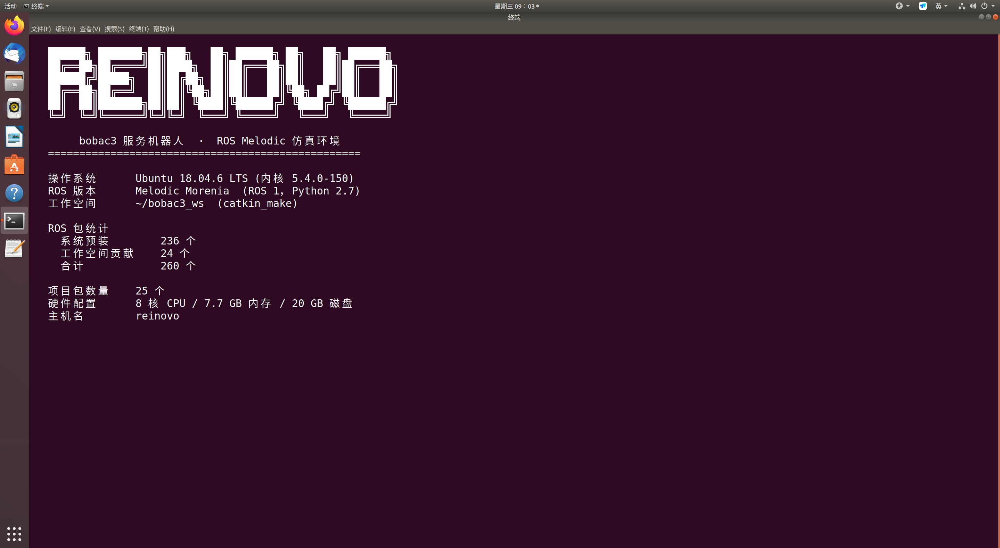
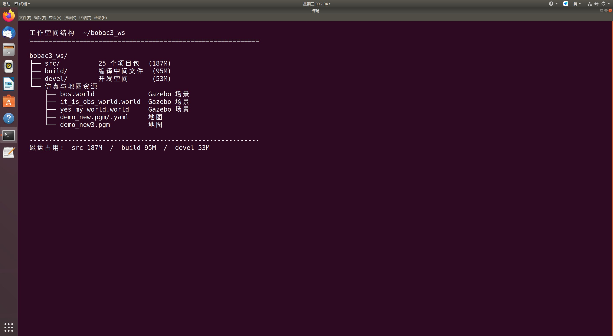
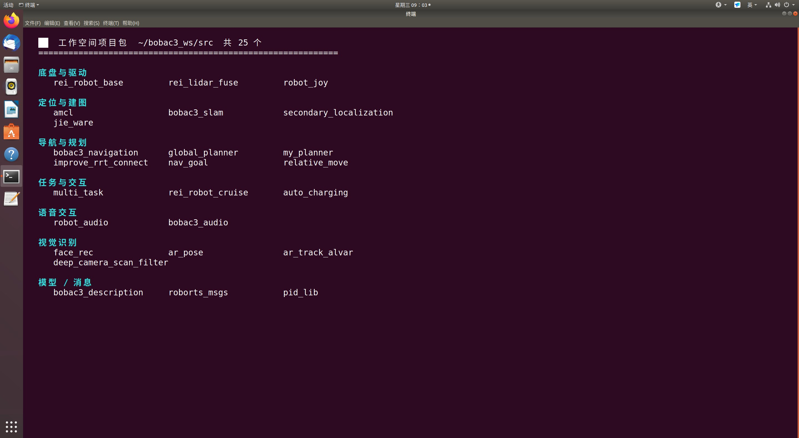
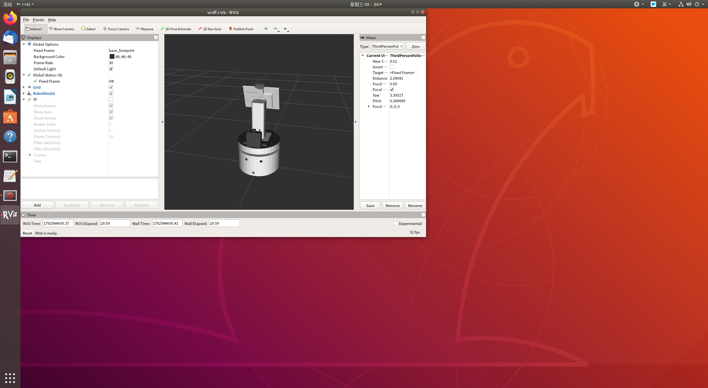
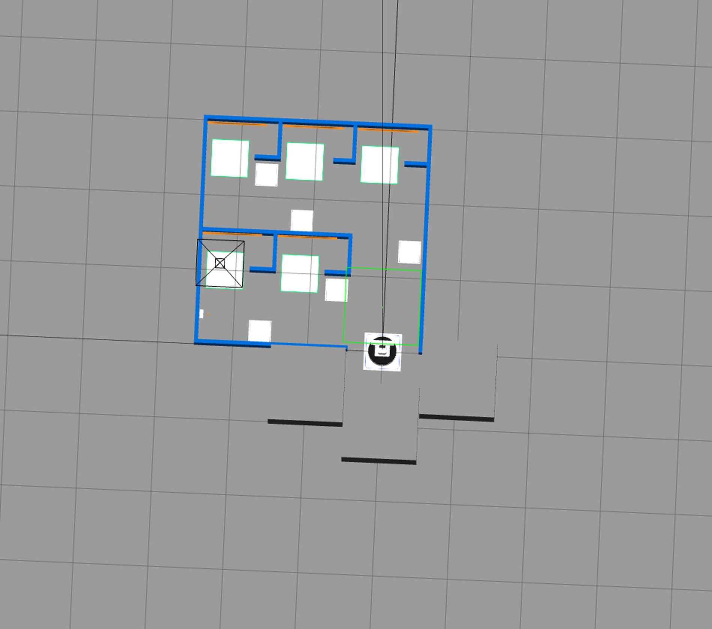

# reinovo bobac3 · ROS Melodic 服务机器人仿真工程

> 从 VMware 虚拟机归档的完整 ROS 1 源码工程，包含底盘驱动、定位建图、导航规划、语音交互、视觉识别与 Gazebo 仿真。



---

## 一、项目简介

本项目是 **reinovo（瑞诺）bobac3 服务机器人** 的 ROS 1 仿真工作空间源码归档。

工程原本运行在一台 VMware 虚拟机中，用于服务机器人（送餐、消杀、引导等场景）的算法验证与仿真调试。仓库保存了 `~/bobac3_ws/src` 下的全部 **26 个 ROS 功能包**，涵盖从底层底盘驱动到上层多任务调度的完整链路。

工程特点：

- **完整的导航栈**：AMCL 定位 → 全局规划（A\*/Dijkstra/RRT-Connect）→ move_base 局部控制
- **三套 SLAM 方案**：GMapping、Cartographer、RTabMap，均提供实车版与仿真版 launch
- **语音交互**：集成科大讯飞 AIUI，支持唤醒、语音识别、语义理解、TTS 播报
- **视觉能力**：人脸识别、AR 标签位姿估计、深度相机转激光滤波
- **Gazebo 仿真**：3 个自定义 `.world` 场景 + 机器人 URDF/Xacro 模型

---

## 二、运行环境

| 项目 | 配置 |
|---|---|
| 操作系统 | Ubuntu 18.04.6 LTS |
| 内核 | 5.4.0-150-generic |
| ROS 版本 | **Melodic Morenia**（ROS 1，2018 LTS） |
| Python | **Python 2.7**（Melodic 默认） |
| 构建系统 | `catkin_make` |
| 工作空间 | `~/bobac3_ws` |
| 硬件规格 | 8 核 CPU / 7.7 GB 内存 / 20 GB 磁盘 |
| 虚拟化 | VMware Workstation |

**ROS 包统计**

| 来源 | 数量 |
|---|---|
| 系统预装 `ros-melodic-*` | 236 个 |
| 工作空间贡献 | 24 个（`rospack` 可索引） |
| 源码包总数（`package.xml` 计数） | **26 个** |
| 索引合计 | 260 个 |

> 说明：源码包 26 个，`rospack` 索引到 24 个，差异源于部分包名与系统包重名（如 `amcl`、`global_planner`）被系统包覆盖，属正常现象。

---

## 三、目录结构



```
bobac3_ws/
├── README.md                本文件
├── docs/images/             文档截图
├── src/                     26 个 ROS 功能包（源码）
│   ├── rei_robot_base/      底盘驱动
│   ├── rei_lidar_fuse/      多雷达融合
│   ├── bobac3_description/  URDF 模型 + Gazebo 仿真
│   ├── bobac3_navigation/   导航栈配置
│   ├── bobac3_slam/         建图方案
│   ├── ...
│   └── robot_audio/         讯飞语音交互
├── build/                   编译中间文件（未纳入版本库）
├── devel/                   开发空间（未纳入版本库）
├── bos.world                Gazebo 场景
├── it_is_obs_world.world    Gazebo 场景（含障碍物）
├── yes_my_world.world       Gazebo 场景
├── demo_new.pgm / .yaml     地图
└── demo_new3.pgm            地图
```

**磁盘占用参考**：`src` 约 187 MB，`build` 约 95 MB，`devel` 约 53 MB。

---

## 四、功能包清单



### 4.1 底盘与硬件驱动

| 包名 | 版本 | 说明 | 关键接口 |
|---|---|---|---|
| `rei_robot_base` | 0.0.0 | 底盘驱动：运动学解算、电机控制、IO 与防跌落 | msg: `CarData` `MotorCmd` `BumperCliff`<br>srv: `SetIO` `Int8` |
| `rei_lidar_fuse` | 0.0.0 | 多路激光雷达数据融合（nodelet 实现） | `lidar_fuse_nodelet.launch` |
| `robot_joy` | 0.0.0 | 手柄遥控节点 | `robot_joy.launch` |

### 4.2 定位与建图

| 包名 | 版本 | 说明 | 关键接口 |
|---|---|---|---|
| `amcl` | 1.17.1 | 自适应蒙特卡洛定位（定制版） | `amcl_node.cpp` |
| `bobac3_slam` | 0.0.0 | 三套建图方案：GMapping / Cartographer / RTabMap | `bobac3_gmapping.launch`<br>`bobac3_cartographer.launch`<br>`bobac3_rtabmap_sim.launch` |
| `secondary_localization` | 0.0.0 | 二次定位与目标跟踪 | `track.launch` |
| `jie_ware` | 0.1.0 | 激光定位 + 代价地图清理 | `lidar_loc.cpp` `costmap_cleaner.cpp` |

### 4.3 导航与路径规划

| 包名 | 版本 | 说明 | 关键接口 |
|---|---|---|---|
| `bobac3_navigation` | 0.0.0 | 导航栈配置：AMCL / move_base / map_server / Cartographer | `demo_nav_2d.launch`<br>`move_base.launch`<br>`amcl.launch` |
| `global_planner` | 1.16.6 | 全局规划器：A\*、Dijkstra、梯度路径 | `astar.cpp` `dijkstra.cpp`<br>`gradient_path.cpp` |
| `my_planner` | 0.0.0 | 自研全局规划器 | `my_planner.cpp` |
| `improve_rrt_connect` | 0.0.0 | 改进 RRT-Connect 采样规划，含社交避障版与语音版 | `Improve_RRT_Connect.py`<br>`social_Improve_RRT_Connect.py` |
| `nav_goal` | 0.0.0 | 导航目标点发布、TF 监听 | `nav.launch` `nav2.launch` |
| `relative_move` | 0.0.0 | 相对当前位置移动（前进/后退/横移/旋转） | srv: `SetRelativeMove` |

### 4.4 任务调度与交互

| 包名 | 版本 | 说明 | 关键接口 |
|---|---|---|---|
| `multi_task` | 0.0.0 | 多任务编排：送餐流程、多点循环导航 | `meals_delivered.launch`<br>`multipoint_nav.launch` |
| `rei_robot_cruise` | 0.0.0 | 巡航：多目标点顺序导航与状态管理 | srv: `SetGoals` `SetNavOrder`<br>`StartStopNav` `RemoveGoal` |
| `auto_charging` | 0.0.0 | 自动回充对接 | srv: `SetCharge` |

### 4.5 语音交互

| 包名 | 版本 | 说明 | 关键接口 |
|---|---|---|---|
| `robot_audio` | 0.0.0 | 科大讯飞 AIUI：唤醒、识别、语义、TTS | srv: `Awake` `Collect` `Control`<br>`robot_iat` `robot_tts` `robot_semanteme` 等 8 个 |
| `bobac3_audio` | 0.0.0 | 语音导航封装 | `voice.launch` `voice_nav.launch` |

### 4.6 视觉识别

| 包名 | 版本 | 说明 | 关键接口 |
|---|---|---|---|
| `face_rec` | 0.0.0 | 人脸检测与识别（C++ + Python 双实现） | msg: `face_data` `face_results`<br>srv: `recognition_results` |
| `ar_pose` | 0.0.0 | AR 标签位姿估计，支持多相机安装位置 | msg: `ArPose` / srv: `Track`<br>8 个 launch（base/hand/head/usbcam） |
| `ar_track_alvar` | — | ALVAR 标签跟踪（内含 `ar_track_alvar` 与 `ar_track_alvar_msgs` 两个包） | 第三方开源库 |
| `deep_camera_scan_filter` | 0.0.0 | 深度相机点云转换为伪激光扫描并滤波 | `scan_filter.launch` |

### 4.7 模型、仿真与消息库

| 包名 | 版本 | 说明 | 关键接口 |
|---|---|---|---|
| `bobac3_description` | 1.0.0 | 机器人 URDF/Xacro 模型与 Gazebo 仿真 | `display.launch` `gazebo.launch`<br>`gazebo_arm.launch` `gazebo_me6.launch` |
| `roborts_msgs` | 2.0.0 | RoboMaster 风格消息定义 | msg: `GameStatus` `LocationInfo` `RobotStatus`<br>srv: `Relocate` `PidPlannerStatus` |
| `pid_lib` | 0.0.0 | PID 控制算法库（纯库，无节点） | 头文件/源码库 |

---

## 五、快速开始

### 5.1 安装 ROS Melodic

```bash
# 依次执行（Ubuntu 18.04）
sudo sh -c 'echo "deb http://packages.ros.org/ros/ubuntu $(lsb_release -sc) main" > /etc/apt/sources.list.d/ros-latest.list'
sudo apt-key adv --keyserver 'hkp://keyserver.ubuntu.com:80' --recv-key C1CF6E31E6BADE8868B172B4F42ED6FBAB17C654
sudo apt update
sudo apt install -y ros-melodic-desktop-full
sudo rosdep init && rosdep update
echo "source /opt/ros/melodic/setup.bash" >> ~/.bashrc
source ~/.bashrc
```

基础依赖：

```bash
sudo apt install -y python-catkin-tools python-rosdep python-wstool \
                    ros-melodic-cartographer-ros ros-melodic-rtabmap-ros \
                    ros-melodic-gmapping ros-melodic-navigation \
                    ros-melodic-joy ros-melodic-nodelet
```

### 5.2 获取源码并编译

```bash
# 直接把仓库克隆为工作空间目录
git clone https://github.com/kang-jia-ning/reinovo_Melodic.git ~/bobac3_ws
cd ~/bobac3_ws

# 安装剩余依赖（可选，需要 rosdep 已初始化）
rosdep install --from-paths src --ignore-src -r -y

# 编译
catkin_make

# 加载环境（建议写入 ~/.bashrc）
source ~/bobac3_ws/devel/setup.bash
```

> 编译前请确认 `src/` 下没有被 `package.xml` 覆盖的同名包与系统包冲突。若报错 `The specified base path contains a CMakeLists.txt but no package.xml`，检查是否有多余目录。

---

## 六、常用启动命令

### 6.1 仅查看机器人模型（RViz）

```bash
roslaunch bobac3_description display.launch
```



启动后会打开 `joint_state_publisher_gui` 关节控制面板与 RViz，可拖动滑块观察各关节运动。

### 6.2 Gazebo 仿真环境

```bash
roslaunch bobac3_description gazebo.launch
```



默认加载 `yes_my_world.world`。如需其他场景，修改 launch 中 `world_name` 参数，可选：

- `bos.world`
- `it_is_obs_world.world`（含障碍物）
- `yes_my_world.world`

切换场景示例：

```bash
roslaunch bobac3_description gazebo.launch world_name:=$(rospack find bobac3_description)/world/bos.world
```

### 6.3 建图

```bash
# GMapping（实车）
roslaunch bobac3_slam bobac3_gmapping.launch

# GMapping（仿真）
roslaunch bobac3_slam bobac3_gmapping_sim.launch

# Cartographer（实车）
roslaunch bobac3_slam bobac3_cartographer.launch

# Cartographer（仿真）
roslaunch bobac3_slam bobac3_cartographer_sim.launch

# RTabMap（仿真）
roslaunch bobac3_slam bobac3_rtabmap_sim.launch
```

### 6.4 导航

```bash
# 2D 导航（含地图加载）
roslaunch bobac3_navigation demo_nav_2d.launch

# 仅 AMCL 定位
roslaunch bobac3_navigation amcl.launch

# move_base 单独启动
roslaunch bobac3_navigation move_base.launch

# Cartographer 纯定位模式
roslaunch bobac3_navigation cartographer.launch
```

### 6.5 语音与任务

```bash
# 语音交互（需讯飞 AIUI 授权与硬件麦克风）
roslaunch robot_audio voice_interaction.launch
roslaunch robot_audio voice_control.launch

# 语音导航
roslaunch bobac3_audio voice_nav.launch

# 送餐任务
roslaunch multi_task meals_delivered.launch

# 多点巡航导航
roslaunch multi_task multipoint_nav.launch
roslaunch rei_robot_cruise example.launch
```

### 6.6 自动回充

```bash
roslaunch auto_charging auto_charging.launch
```

---

## 七、注意事项

### 7.1 Python 版本

本项目基于 **Ubuntu 18.04 + ROS Melodic**，默认解释器是 **Python 2.7**。

- 源码中部分脚本使用 `#!/usr/bin/env python`，在 18.04 上即指向 Python 2
- **不要**直接在 Ubuntu 20.04 / ROS Noetic 上运行，会因 Python 3 语法与字节字符串差异大量报错
- 如需迁移到 Noetic，参考对照：

| Python 2 | Python 3 |
|---|---|
| `print "x"` | `print("x")` |
| `import urllib2` | `import urllib.request` |
| `except E, e:` | `except E as e:` |
| `xrange` | `range` |

可用 `2to3` 辅助转换，但 ROS 消息的 `bytes/str` 边界需人工核对。

### 7.2 硬件强依赖

下列包与 reinovo 硬件绑定，脱离实车无法正常工作：

`rei_robot_base`、`rei_lidar_fuse`、`robot_joy`、`auto_charging`、`robot_audio`

这些包依赖底盘串口协议、雷达型号、讯飞 AIUI SDK 与授权文件，仅供代码研究与仿真参考。

### 7.3 讯飞 AIUI 授权

`robot_audio` 内的 `AIUI/` 目录包含讯飞 AIUI SDK 与配置文件，需要**有效的 appid 与授权**才能连接云端服务。仓库中的配置仅在原作者环境有效，直接运行会报鉴权失败。

### 7.4 路径依赖

源码中共有 **114 处**硬编码的绝对路径 `/home/bobac3/...`，主要集中在：

- `bobac3_description/world/*.world` — STL 网格的 `<uri>` 引用（3 个 world 文件各 21 处）
- `nav_goal/src/tiaoshi*.cpp` — 语音文件路径（`play /home/bobac3/.../voices/*.wav`）
- `bobac3_navigation/maps/test.yaml` — 地图图像路径

迁移到其他用户名或目录时需要批量替换：

```bash
grep -rl "/home/bobac3" ~/bobac3_ws/src | xargs sed -i "s|/home/bobac3|$HOME|g"
```

> 另有一处历史遗留错误：`bobac3_navigation/maps/rtab_map.yaml` 指向 `/home/bobac3/ros_workspace/src/...`（旧工作空间名），该地图文件可能无法直接加载，使用时请修正路径。

### 7.5 磁盘空间

`src` 含大量 STL 网格、音频与地图文件（原始约 187 MB），加上 `build`/`devel` 后完整工作空间约 **350 MB**。原虚拟机的 20 GB 磁盘已使用 89%，克隆前请预留充足空间。

### 7.6 第三方库说明

- `ar_track_alvar` 为第三方开源库（ALVAR），归其原作者所有
- `amcl`、`global_planner` 基于 ROS navigation 官方实现修改
- 其余 `rei_*`、`bobac3_*` 为本项目代码

---

## 八、免责声明

本仓库为**个人学习用途的源码归档**，内容采集自本地 VMware 虚拟机中的 ROS 工作空间。

- 不包含任何商业授权
- 硬件驱动与厂商 SDK 仅供研究与学习
- 涉及商标、SDK 授权的内容归其各自权利人所有
- 生产环境使用请自行评估风险

---

## 附：文档截图来源

本文所有配图均为从原虚拟机 **实机截取** 的真实屏幕截图，非示意图：

| 图片 | 内容 |
|---|---|
| `01-system-overview.jpg` | 系统与 ROS 版本概览 |
| `02-package-list.jpg` | 26 个功能包分类列表 |
| `03-workspace-structure.jpg` | 工作空间目录与磁盘占用 |
| `04-rviz-robot-model.jpg` | RViz 中加载的 bobac3 机器人模型 |
| `05-gazebo-world.jpg` | Gazebo 仿真世界（yes_my_world） |
