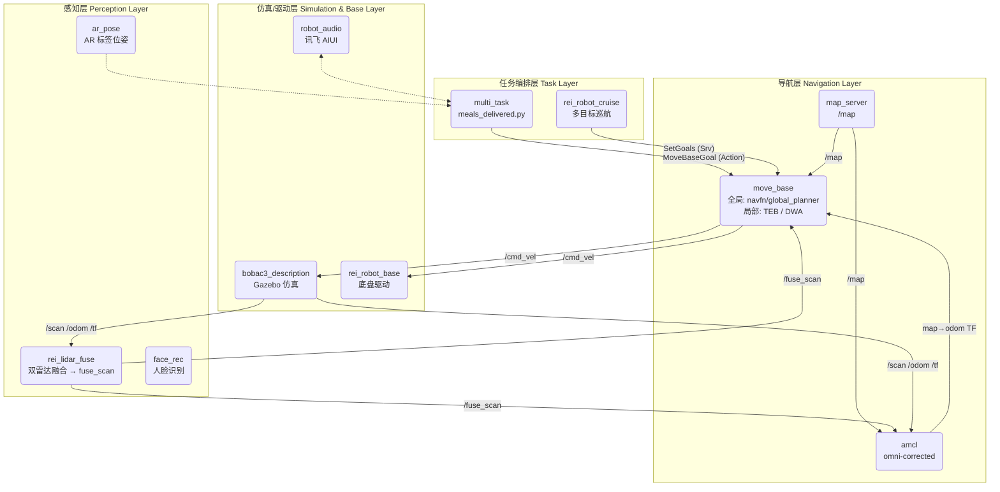

# reinovo bobac3 · ROS Melodic 服务机器人仿真工程


## 1. 项目概述

本项目是一个基于 ROS Melodic 和 Gazebo 的服务机器人综合仿真工程，源自 reinovo（瑞诺）公司 **bobac3 服务机器人**的算法开发虚拟机，用于模拟和测试服务机器人在室内展馆环境中的**自主建图、定位导航、语音交互和任务执行**能力。

工程覆盖从底层底盘驱动到高层任务调度的完整技术栈：26 个 ROS 功能包组成了「感知 → 定位 → 规划 → 控制 → 任务」的完整闭环，既支持实车部署，也提供 Gazebo 仿真版本，所有核心模块均提供实车版与仿真版两套 launch 文件。

**核心场景**：展馆导览送餐机器人——机器人依次导航至上海馆、深圳馆、吉林馆、广州馆、北京馆等展位，到达后语音讲解展馆介绍，任务结束后返回充电桩自动充电。


---

## 2. 核心功能

* **三套 SLAM 方案可选**：集成 GMapping、Cartographer、RTabMap 三种建图算法，通过 launch 参数一键切换，实车与仿真版本分离。
* **双导航栈配置**：实车使用 TEB 局部规划器（动态避障平滑），仿真使用 DWA 局部规划器（轻量稳定），全局规划器分别为 navfn 与 global_planner，参数按实车/仿真分目录管理。
* **全向轮里程计模型**：AMCL 采用 `omni-corrected` 里程计模型，专为麦克纳姆轮全向底盘调优。
* **双雷达数据融合**：`rei_lidar_fuse` 通过 nodelet 将前后两路激光雷达融合为单一的 `fuse_scan` 话题，实现 360° 无死角覆盖。
* **语音交互闭环**：集成科大讯飞 AIUI SDK，支持语音唤醒、离线识别、语义理解和 TTS 播报，导航点与语音讲解内容联动。
* **任务序列编排**：通过 YAML 定义任务序列（导航点 + 语音 + 等待 + 相对移动），由 `multi_task` 主控循环执行，无需修改代码即可调整任务流程。
* **AR 视觉定位**：`ar_pose` 支持底座/手臂/头部三个相机安装位姿，用于充电桩对接等高精度定位场景。
* **完整 Gazebo 仿真**：自定义机器人 URDF/Xacro 模型（含底盘、机械臂、多传感器）与 3 个室内展馆 `.world` 场景。

---

## 3. 系统架构

#### 3.1. 总体设计

系统采用分层模块化架构，各功能包通过 ROS 的 Topics / Services / Actions 通信机制解耦。整体分为四层：

| 层级 | 功能包 | 职责 |
|---|---|---|
| **任务层** | `multi_task` | 任务序列编排、语音播报联动、异常处理 |
| **导航层** | `bobac3_navigation`、`amcl`、`global_planner`、`my_planner` | 定位、路径规划、运动控制 |
| **感知层** | `rei_lidar_fuse`、`face_rec`、`ar_pose`、`deep_camera_scan_filter` | 传感器融合与视觉识别 |
| **驱动层** | `rei_robot_base`、`robot_joy`、`robot_audio` | 底盘控制、手柄遥控、语音硬件 |

#### 3.2. 架构图



#### 3.3. 数据流

1. **环境感知**：Gazebo 仿真插件（或实车驱动）发布激光雷达数据 `/scan`、轮式里程计 `/odom` 和 TF 坐标变换；`rei_lidar_fuse` 将前后双雷达数据融合为 `/fuse_scan`。
2. **地图服务**：`map_server` 加载 `bobac3_navigation/maps/` 下预建的栅格地图（22 个版本），发布到 `/map` 话题。
3. **自主定位**：AMCL 节点订阅 `/fuse_scan`、`/odom`、`/map`，使用 `omni-corrected` 全向里程计模型和 likelihood_field 激光模型，输出 `map → odom` 的 TF 变换和位姿估计。
4. **任务下发**：`multi_task` 读取 `task_sequence.yaml` 任务序列，通过 actionlib 向 `move_base` 发送 `MoveBaseGoal` 目标点。
5. **路径规划与执行**：`move_base` 全局规划器基于静态地图计算最优路径，局部规划器（TEB/DWA）根据实时传感器数据动态避障，输出 `/cmd_vel` 速度指令。
6. **物理执行**：底盘驱动（或 Gazebo 插件）订阅 `/cmd_vel`，转换为麦轮速度并驱动机器人运动。
7. **任务联动**：到达目标点后，`multi_task` 调用 `robot_audio` 服务播放对应的展馆讲解语音，随后执行下一个任务项。

---

## 4. 环境要求

* **操作系统**：Ubuntu 18.04 LTS（Melodic 官方支持版本）
* **ROS 版本**：ROS Melodic Morenia（建议安装 `ros-melodic-desktop-full`）
* **核心依赖包**：

```bash
sudo apt install -y \
    ros-melodic-navigation \
    ros-melodic-gmapping \
    ros-melodic-cartographer-ros \
    ros-melodic-rtabmap-ros \
    ros-melodic-map-server \
    ros-melodic-move-base \
    ros-melodic-amcl \
    ros-melodic-joy \
    ros-melodic-nodelet
```

* **Python**：Python 2.7（Ubuntu 18.04 默认，**勿用 Python 3**）
* **硬件（实车部署时）**：bobac3 底盘、前后双激光雷达、麦克风阵列、USB 相机

---

## 5. 安装与配置

#### 5.1. 获取源码

```bash
git clone https://github.com/kang-jia-ning/reinovo_Melodic.git ~/bobac3_ws
cd ~/bobac3_ws
```

> 项目原始路径为 `/home/bobac3/bobac3_ws`，源码中有 114 处硬编码绝对路径。若使用其他用户名，请执行：
> ```bash
> grep -rl "/home/bobac3" src | xargs sed -i "s|/home/bobac3|$HOME|g"
> ```

#### 5.2. 安装依赖

```bash
cd ~/bobac3_ws
rosdep install --from-paths src --ignore-src -r -y
```

#### 5.3. 编译

```bash
cd ~/bobac3_ws
catkin_make
```

#### 5.4. 配置环境

```bash
echo "source ~/bobac3_ws/devel/setup.bash" >> ~/.bashrc
source ~/.bashrc
```

---

## 6. 使用说明

#### 6.1. 查看机器人模型（RViz）

```bash
roslaunch bobac3_description display.launch
```


启动后同时打开 `joint_state_publisher_gui` 关节控制面板，可拖动滑块观察底盘轮组与机械臂关节运动。

#### 6.2. 启动 Gazebo 仿真

```bash
roslaunch bobac3_description gazebo.launch
```


默认加载 `yes_my_world.world` 展馆场景。可选场景：

| 场景文件 | 说明 |
|---|---|
| `yes_my_world.world` | 标准展馆布局（默认） |
| `bos.world` | 备用展馆场景 |
| `it_is_obs_world.world` | 含额外障碍物场景 |

#### 6.3. SLAM 建图

```bash
# 仿真：GMapping（默认）
roslaunch bobac3_slam bobac3_slam_sim.launch

# 仿真：Cartographer
roslaunch bobac3_slam bobac3_slam_sim.launch slam_methods:=cartographer

# 仿真：RTabMap
roslaunch bobac3_slam bobac3_slam_sim.launch slam_methods:=rtabmap

# 实车：GMapping（使用融合雷达 fuse_scan）
roslaunch bobac3_slam bobac3_slam.launch
```

遥控机器人扫完场景后保存地图：

```bash
roslaunch bobac3_slam rtabmap_saver.launch
# 或手动
rosrun map_server map_saver -f ~/bobac3_ws/src/bobac3_navigation/maps/my_map
```

#### 6.4. 自主导航

```bash
# 仿真导航（Gazebo + map_server + AMCL + move_base + RViz 一键启动）
roslaunch bobac3_navigation demo_nav_2d.launch

# 指定地图与定位方式
roslaunch bobac3_navigation demo_nav_2d.launch \
    map_file_name:=demonew3 \
    location_method:=amcl_sim
```


启动内容：

| 组件 | 来源 | 说明 |
|---|---|---|
| Gazebo 仿真 | `bobac3_description/gazebo.launch` | 场景 + 机器人 |
| map_server | `map_server.launch` | 加载 `maps/demonew.yaml` |
| AMCL | `amcl_sim.launch` | 全向轮模型，500–2000 粒子 |
| move_base | `move_base_sim.launch` | DWA 局部规划（仿真） |
| costmap_cleaner | `jie_ware` 包 | 定期清理代价地图残留 |

在 RViz 中使用 **2D Nav Goal** 工具发送目标点，机器人即自主规划并移动。

#### 6.5. 运行导览任务

```bash
roslaunch multi_task meals_delivered.launch
```


该命令同时启动语音交互（AIUI）、AR 定位、自动回充、相对移动四个子系统，并运行 `meals_delivered.py` 主控脚本，按 `task_sequence.yaml` 定义的序列依次执行导航 → 语音讲解 → 返回充电。

#### 6.6. 单模块测试

```bash
# 相对移动：前进 0.2m
rosservice call /relative_move "frame: base_link
target: [0.2, 0, 0]"

# 自动充电
rosservice call /set_charge "..."

# 多目标巡航
roslaunch rei_robot_cruise example.launch
```

---

## 7. 模块规格详述

#### 7.1. `src/bobac3_description`: 模型与仿真模块

* **职责**：定义 bobac3 机器人的 URDF/Xacro 模型，提供 Gazebo 仿真环境。
* **组件**：
  * `xacro/bobac3_serverbot.xacro`：机器人主模型，包含麦克纳姆轮底盘、6 自由度机械臂、前后双激光雷达、深度相机、超声波传感器、防跌落传感器。
  * `xacro/bobac3_arm.xacro`、`bobac3_base.xacro`：机械臂与底盘子模块。
  * `xacro/gazebo_plugin.xacro`：Gazebo 差速/全向驱动插件、激光雷达插件、相机插件配置。
  * `launch/display.launch`：模型可视化（RViz + joint_state_publisher_gui）。
  * `launch/gazebo.launch`：仿真主启动文件，加载 world 并 spawn 机器人。
  * `meshes/`：50+ 个 STL 网格文件（底盘、轮组、相机支架、配送箱等）。
  * `gazebo_kinematics.cpp`：仿真运动学解算辅助节点。

#### 7.2. `src/bobac3_navigation`: 导航配置模块

* **职责**：集成 ROS 导航栈，管理所有导航参数与地图资源。
* **组件**：
  * `launch/demo_nav_2d.launch`：一键导航入口，串联 Gazebo + map_server + move_base + AMCL + RViz。
  * `launch/move_base.launch`（实车）/**`move_base_sim.launch`（仿真）**：导航核心，参数加载方式相同但调优值不同。
    * **实车全局规划器**：navfn（Dijkstra 实现）
    * **仿真全局规划器**：global_planner（A\* 实现）
    * **实车局部规划器**：TEB（Timed Elastic Band，动态避障平滑）
    * **仿真局部规划器**：DWA（Dynamic Window Approach）
  * `launch/amcl_sim.launch`：AMCL 定位，关键参数——
    * `odom_model_type: omni-corrected`（全向轮专用）
    * `min/max_particles: 500/2000`
    * `laser_max_range: 12.0 m`
    * `update_min_d: 0.25 m`（位置更新阈值）
  * `param/sim/`、`param/`：代价地图、规划器参数，按实车/仿真分目录管理。
  * `maps/`：**22 个地图版本**（`.pgm` + `.yaml`），包含展馆、走廊等多种场景，含 Cartographer 的 `.pbstream` 格式。

#### 7.3. `src/bobac3_slam`: 建图模块

* **职责**：提供三种 SLAM 方案的统一接口。
* **组件**：
  * `bobac3_slam.launch` / `bobac3_slam_sim.launch`：总入口，通过 `slam_methods` 参数切换算法。
  * `bobac3_gmapping.launch`：GMapping 建图。实车版订阅融合话题 `fuse_scan`，仿真版订阅 `scan`。
  * `bobac3_cartographer.launch`：Cartographer 建图，配置文件 `bobac3_2d.lua`（实车）/ `bobac3_2d_sim.lua`（仿真），含 `cartographer_occupancy_grid_node` 栅格转换。
  * `bobac3_rtabmap_sim.launch`：RTabMap RGB-D 建图，含 `rgbd_sync` 同步节点与点云生成。
  * `rtabmap_saver.launch`：地图保存。

#### 7.4. `src/rei_robot_base`: 底盘驱动模块

* **职责**：bobac3 底盘的串口通信、运动学解算与状态反馈。
* **组件**：
  * `base_node.cpp`：主节点，串口收发、状态轮询。
  * `kinematics.cpp`：麦克纳姆轮运动学正逆解（`/cmd_vel` → 四轮转速）。
  * **ROS API**：
    * 订阅：`/cmd_vel`（geometry_msgs/Twist）
    * 发布：`/car_data`（CarData：电池电压、电机电流）、`/bumper_cliff`（BumperCliff：防撞防跌）
    * 服务：`/set_io`（SetIO：IO 口控制）
  * `launch/bobac3_base.launch`：实车底盘启动入口。

#### 7.5. `src/rei_lidar_fuse`: 双雷达融合模块

* **职责**：将前后两路激光雷达的点云融合为单一 360° 扫描数据。
* **组件**：
  * `lidar_fuse_nodelet.cpp`：nodelet 实现，零拷贝降低延迟。
  * `launch/lidar_fuse_nodelet.launch`：加载 nodelet manager 与融合节点。
  * 输出话题：`/fuse_scan`（sensor_msgs/LaserScan），供 AMCL 与 move_base 消费。

#### 7.6. `src/robot_audio`: 语音交互模块

* **职责**：基于科大讯飞 AIUI 的完整语音链路。
* **组件**：
  * `voice_awake`：语音唤醒（离线）。
  * `voice_collect`：音频采集与 VAD 端点检测。
  * `robot_aiui.cpp`：AIUI SDK 封装，在线识别与语义理解。
  * `voice_nav.cpp`：语音导航指令解析（「去上海馆」→ 导航目标）。
  * **服务接口**：`/robot_iat`（语音转文字）、`/robot_tts`（文字转语音）、`/robot_semanteme`（语义理解）、`/awake`（唤醒）等 8 个。
  * `AIUI/`：讯飞 SDK、授权文件与声学模型（**需有效 appid**）。

#### 7.7. `src/multi_task`: 任务调度模块

* **职责**：导览送餐任务的主控逻辑，串联导航、语音、充电、视觉。
* **组件**：
  * `meals_delivered.py`：展馆导览主控（Python 2）。
  * `multipoint_nav.py`：多点循环导航。
  * `param/navigation_point.yaml`：**导航点坐标表**，包含出发点、充电桩、上海馆、深圳馆、吉林馆、广州馆、北京馆等，每项为 `position` + `orientation` 四元数。
  * `param/task_sequence.yaml`：**任务序列定义**，支持的动作类型：

| 动作 | 说明 | 示例 |
|---|---|---|
| `nav_goal` | 导航到指定点 | `point 出发点` |
| `voice_tts` | TTS 播报 | `str 上海是中国的经济中心` |
| `play_audio` | 播放音频文件 | `str 自动充电成功.wav` |
| `wait_voice` | 等待语音指令 | `str 参观` |
| `wait_time` | 定时等待 | `val 5` |
| `relative_move` | 相对移动 | `val [0.2,0,0]` |
| `goto_charging` | 触发自动充电 | `val False` |

#### 7.8. `src/improve_rrt_connect`: 改进采样规划模块

* **职责**：研究性算法包，实现改进的 RRT-Connect 路径规划。
* **组件**：
  * `Improve_RRT_Connect.py`：基础改进版（偏置采样 + 剪枝优化）。
  * `social_Improve_RRT_Connect.py`：社交感知版（避让人群密集区）。
  * `voice_Improve_RRT_Connect.py`：与语音联动的演示版。

#### 7.9. 其他功能包

| 包 | 职责 | 关键接口 |
|---|---|---|
| `auto_charging` | 红外对桩自动充电 | srv: `/set_charge` |
| `relative_move` | 以机器人坐标系相对移动 | srv: `/set_relative_move` |
| `ar_pose` | AR 标签位姿估计 | msg: `ArPose`；8 个 launch 覆盖三种相机位 |
| `face_rec` | 人脸检测识别 | srv: `/recognition_results` |
| `deep_camera_scan_filter` | 深度相机转伪激光 + 滤波 | `scan_filter.launch` |
| `nav_goal` | 目标点发布与 TF 监听 | `nav.launch` |
| `jie_ware` | 代价地图清理 + 激光定位 | `costmap_cleaner` 节点 |
| `my_planner` | 自研全局规划器 | nav_core 插件 |
| `pid_lib` | PID 控制库 | 纯 C++ 库 |
| `global_planner` | A\*/Dijkstra 实现 | ROS 官方定制版 |
| `amcl` | 蒙特卡洛定位 | ROS 官方定制版 |
| `robot_joy` | 手柄遥控 | `/joy` → `/cmd_vel` |
| `secondary_localization` | 二次精定位 | `track.cpp` |
| `bobac3_audio` | 语音导航封装 | `voice_nav.launch` |
| `roborts_msgs` | 比赛风格消息定义 | GameStatus/Relocate 等 |

---

## 8. 系统工作流程详解

以**展馆导览任务**（`meals_delivered.launch`）为例：

1. **启动与编排**：launch 依次启动 `robot_audio`（AIUI 语音）、`ar_pose`（AR 定位）、`auto_charging`（回充）、`relative_move`（相对移动）子系统，最后运行 `meals_delivered.py` 主控。
2. **环境加载**：`bobac3_description/gazebo.launch` 启动 Gazebo，加载 `yes_my_world.world` 展馆场景并 spawn 机器人。
3. **地图发布**：`map_server` 加载 `maps/demonew.yaml`，向全系统发布 `/map`。
4. **传感器就绪**：Gazebo 插件发布 `/scan`、`/odom`、`/tf`；实车时 `rei_lidar_fuse` 将双雷达融合为 `/fuse_scan`。
5. **机器人定位**：AMCL 融合地图与激光数据，收敛粒子群，发布 `map → odom` TF。
6. **任务解析**：`meals_delivered.py` 读取 `task_sequence.yaml`，解析出任务队列（出发点 → 各展馆 → 充电桩）。
7. **任务下发**：通过 actionlib 向 `move_base` 发送第一个 `MoveBaseGoal`（如「上海馆」坐标）。
8. **全局规划**：move_base 基于 `/map` 用 navfn/global_planner 计算最优路径。
9. **局部控制**：TEB（实车）或 DWA（仿真）局部规划器根据实时代价地图动态避障，输出 `/cmd_vel`。
10. **物理执行**：底盘驱动（或 Gazebo 插件）解算麦轮速度，驱动机器人移动。
11. **到达反馈**：move_base 返回 SUCCEEDED，`multi_task` 调用 `/robot_tts` 播报「上海是中国的经济中心」。
12. **任务迭代**：按序列执行下一项，直到最后一个任务触发 `goto_charging` 自动回充，任务结束。

---

## 9. 已知问题与注意事项

* **Python 2.7 专属**：`meals_delivered.py` 等脚本使用 Python 2 语法，**不能**在 ROS Noetic（Python 3）下运行。
* **硬编码路径**：源码中有 114 处 `/home/bobac3/...` 绝对路径（world 的 STL 引用、语音文件路径、地图 yaml），迁移时需批量替换。`bobac3_navigation/maps/rtab_map.yaml` 指向已不存在的旧路径 `~/ros_workspace/`，使用前需修正。
* **讯飞授权**：`robot_audio/AIUI/` 需要有效 appid 才能在线识别，仓库中的配置仅在原作者环境有效。
* **实车专用包**：`rei_robot_base`、`rei_lidar_fuse`、`auto_charging` 依赖 bobac3 硬件（串口协议、雷达型号、红外对桩），脱离实车无法运行。
* **同名包覆盖**：`amcl`、`global_planner` 与 ROS 官方包同名，`rospack` 解析时工作空间版本优先；如需使用官方版本，请注意 `ROS_PACKAGE_PATH` 顺序。

---

## 10. 免责声明

本仓库为**个人学习用途的源码归档**，采集自本地 VMware 虚拟机。

- 涉及的讯飞 AIUI SDK、ALVAR 库归其各自权利人所有
- 硬件驱动仅供研究与学习，生产使用请自行评估
- 不包含任何商业授权

---

## 附：文档截图

所有配图均为从原虚拟机**实机截取**的真实画面：

| 图片 | 内容 |
|---|---|
| `01-system-overview.jpg` | 系统与 ROS 版本概览 |
| `02-package-list.jpg` | 26 个功能包分类列表 |
| `03-workspace-structure.jpg` | 工作空间目录与磁盘占用 |
| `04-rviz-robot-model.jpg` | RViz 中加载的机器人模型 |
| `05-gazebo-world.jpg` | Gazebo 仿真世界（yes_my_world） |
| `06-navigation-params.jpg` | 导航栈参数构成（TEB/DWA/AMCL） |
| `07-task-chain.jpg` | 送餐导览任务链与任务序列 |
