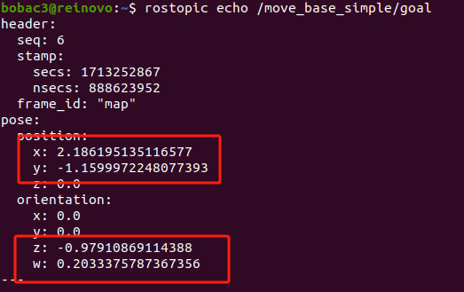

# bobac3多任务导航
基于深圳元创兴科技有限公司，多功能服务机器人套件bobac3机器人。可实现通过配置文件，控制机器人完成相应的任务。可完成迎宾引导、消毒杀菌、送餐等任务。
## 导航点配置
```yaml
navigation_target:
  {导航点名称}:
    position:
      x: 0
      y: 0
    orientation:
      z: 0
      w: 1
.....
```
坐标点可以通过订阅——/move_base_simple/goal

## 任务文件
```yaml
{任务1名称}:
  {动作1}: {参数属性} {参数值}
  {动作2}: {参数属性} {参数值}
  {动作3}: {参数属性} {参数值}
  
{任务2名称}:
  {动作1}: {参数属性} {参数值}
  {动作2}: {参数属性} {参数值}
.....
```
## 动作列表及参数
- 导航到指定位置
  ```yaml
  参数文件格式：
  - nav_goal: point {导航点名称} 
  动作说明：
  - 导航到对应导航点
  前置功能要求：
  - 自主导航（bobac3_navigation/launch/bobac3_nav_2d.launch）
  ```
- 相对移动
  ```yaml
  参数文件配置：
  - relative_move: val [{x},{y},{theta}] 
  动作说明：
  - 基于当前位置向x轴偏移{x}mm，向y轴偏移{y}mm,旋转{theta}弧度
  前置功能要求：
  - 自主导航（bobac3_navigation/launch/bobac3_nav_2d.launch）
  - 相对移动（relative_move/launch/relative_move.launch）
  ```
- 二维码对准
  ```yaml
  参数文件配置：
  - track_marker: val {id} 
  动作说明：
  - 基于当前位置向x轴偏移{x}mm，向y轴偏移{y}mm,旋转{theta}弧度
  前置功能要求：
  - 自主导航（bobac3_navigation/launch/bobac3_nav_2d.launch）
  - 相对移动（relative_move/launch/relative_move.launch）
  ```
- 播放语音文件
  ```yaml
  参数文件配置：
  - play_audio: str {语音文件名} 
  动作说明：
  - 播放语音文件
  前置功能要求：
  - 需要安装依赖库，参考依赖库安装
  ```
- 语音合成
  ```yaml
  参数文件配置：
  - voice_tts: str {需要合成的文本} 
  动作说明：
  - 合成语音并播放
  前置功能要求：
  - 语音接口（robot_audio/launch/voice_aiui.launch）
  ```
- 人脸验证
  ```yaml
  参数文件配置：
  - wait_face_recognition: str {人脸标签（可中文）} 
  动作说明：
  - 等待人脸验证成功
  前置功能要求：
  - 人脸识别（face_rec/launch/face_rec_service.launch）
  - 相机节点
  ```
- 延时等待
  ```yaml
  参数文件配置：
  - wait_time: val {秒} 
  动作说明：
  - 等待指定时间单位为秒
  ```
- 继电器控制
  ```yaml
  参数文件配置：
  - wait_face_recognition: str {人脸标签（可中文）} 
  动作说明：
  - 等待人脸验证成功
  前置功能要求：
  - 人脸识别（face_rec/launch/face_rec_service.launch）
  - 相机节点
  ```re
- io控制
  ```yaml
  参数文件配置：
  - set_io: val {io口数据位0到6} # 控制指定IO置1
  - reset_io: val {io口数据位0到6} # 控制指定IO置0
  - reset_io: str all # 控制所有IO置0
  前置功能要求：
  - 底盘控制（rei_robot_base/launch/bobac3_base.launch）
  ```
## launch文件配置
```xml
<launch>
    <!-- 打开机器人底盘节点 -->
    <include file="{机器人前置功能}"/>

    <!-- 启动多任务 -->
    <node name="meals_delivered" type="meals_delivered.py" pkg="multipoint_navigation" output="screen" >
        <!-- 语音文件目录 -->
        <param name="audio_file" value="$(find multipoint_navigation)/audio/" />
        <!-- 加载导航点配置文件 -->
        <rosparam file="$(find multipoint_navigation)/param/{导航点配置文件}.yaml" command="load" ns="navigation_point"/>
        <rosparam file="$(find multipoint_navigation)/param/{多任务配置文件}.yaml" command="load" ns="task_sequence"/>
    </node>
</launch>

```

## 依赖库
主要用于语音文件的播放功能。
```
sudo apt-get install libasound-dev portaudio19-dev libportaudio2 libportaudiocpp0
sudo pip install PyAudio -i https://pypi.tuna.tsinghua.edu.cn/simple
```

## demo
导航点配置示例，（在param目录下）
```yaml
navigation_target:
  # 餐厅
  canteen:
    position:
      x: 0
      y: 0
    orientation:
      z: 0.7121303031267905
      w: 0.7020473141950943
  # 电梯
  elevator1:
    position:
      x: 6.39715051651001
      y: -0.7087132930755615
    orientation:
      z: 0.9999304946159852
      w: 0.01179007790607127
  elevator2:
    position:
      x: 9.39692211151123
      y: -0.7506863474845886
    orientation:
      z: 0.7124876531982445
      w: 0.7016846471457517
  elevator3:
    position:
      x: 12.012237548828125
      y: -0.7060660123825073
    orientation:
      z: 0.7128619153952126
      w: 0.7013044200481476
  elevator4:
    position:
      x: 14.715211868286133
      y: -0.6596437096595764
    orientation:
      z: 0.7125737627568632
      w: 0.7015972011279161
  log:
    position:
      x: 18.37239646911621
      y: -0.8056628108024597
    orientation:
      z: -0.9999619904253174
      w: 0.008718813258546705
  office401:
    position:
      x: 8.747231483459473
      y: 7.152642726898193
    orientation:
      z: 0.9999819048103981
      w: 0.006015816799745665
  office402:
    position:
      x: 12.459553718566895
      y: 7.571231842041016
    orientation:
      z: 0.7215984550187555
      w: 0.6923118298242094
  office403:
    position:
      x: 14.949150085449219
      y: 7.429768085479736
    orientation:
      z: 0.7073906408058758
      w: 0.7068228075693741
  office404:
    position:
      x: 18.51814842224121
      y: 7.240038871765137
    orientation:
      z: 0.9999686144349339
      w: 0.007922761202914349
  office405:
    position:
      x: 18.901994705200195
      y: 4.864075183868408
    orientation:
      z: -0.00576592394583923
      w: 0.999983376922362
  office406:
    position:
      x: 18.622535705566406
      y: -9.95212173461914
    orientation:
      z: 0.003812084054788048
      w: 0.999992733981182
  office408:
    position:
      x: 15.363021850585938
      y: -12.495347023010254
    orientation:
      z: -0.7091050106093898
      w: 0.7051028888954131
  office409:
    position:
      x: 12.244028091430664
      y: -12.22224235534668
    orientation:
      z: -0.7091050106093898
      w: 0.7051028888954131
  office410:
    position:
      x: 3.8618648052215576
      y: -11.935079574584961
    orientation:
      z: 0.002003960134294311
      w: 0.9999979920698742
  toilet:
    position:
      x: 18.193994522094727
      y: -5.901092052459717
    orientation:
      z: -0.9999136803322739
      w: 0.013138945329334555
```
多任务文件示例:机器人消杀任务（在param目录下）
```yaml
init_1:
  set_relay: val False
  reset_io: str all
task_1: 
  nav_goal: point office402
  play_audio: str 开始执行消杀作业.wav
  set_relay: val True
  set_io: val 1
nav_task_1:
  nav_goal: point office404
nav_task_3:
  nav_goal: point office406
nav_task_2:
  nav_goal: point elevator1
task_2:
  nav_goal: point office405
  set_relay: val False
  reset_io: str all
  play_audio: str 消杀作业已完成.wav
init_2:
  set_relay: val False
  set_io: str all
```
消杀功能启动文件示例（launch目录下）

```xml
<launch>
    <!-- 打开机器人自主导航 -->
    <include file="$(find bobac3_navigation)/launch/bobac3_nav_2d.launch"/>
    <!-- 打开客户端节点 -->
    <node name="meals_delivered" type="meals_delivered.py" pkg="multipoint_navigation" output="screen" >
        <param name="audio_file" value="$(find multipoint_navigation)/audio/" />
        <rosparam file="$(find multipoint_navigation)/param/navigation_point1.yaml" command="load" ns="navigation_point"/>
        <rosparam file="$(find multipoint_navigation)/param/task_sequence_xs.yaml" command="load" ns="task_sequence"/>
    </node>
</launch>
```

